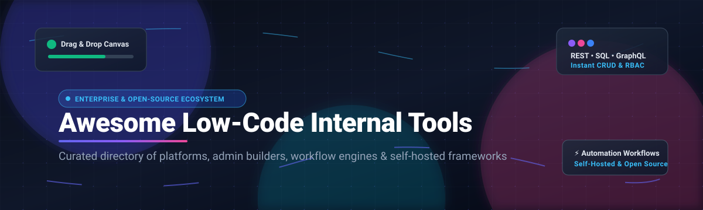

# ⚡ Awesome Low-Code Internal Tools 🛠️

### 🚀 A Curated Directory of SaaS Platforms, Open-Source Admin Builders, and Workflow Engines

  
  
  
  
  

  <strong>Build internal tools, admin portals, operational dashboards, and CRUD apps 10x faster with drag-and-drop canvases, instant SQL/REST connectors, and self-hosted workflows.</strong>

---

## 📌 Overview & Scope

Welcome to **Awesome-Low-Code-Internal-Tools** — the comprehensive, SEO-optimized guide tracking both enterprise **SaaS platforms** and high-velocity **open-source GitHub projects** in the low-code and internal development tool category.

These frameworks enable engineering, product, and operations teams to build back-office admin panels, CRM systems, customer support consoles, approval queues, and database dashboards with minimal boilerplate code. By coupling visual UI component drag-and-drop builders with database connectors (Postgres, MySQL, MongoDB, Snowflake) and API clients (REST, GraphQL, gRPC), modern low-code platforms bridge the gap between custom full-stack software and rigid out-of-the-box SaaS products.

---

## 📑 Table of Contents

- [📊 Sector Overview & Market Dynamics](#-sector-overview--market-dynamics)
- [☁️ SaaS/Hosted Platforms](#️-saashosted-platforms)
- [🔓 Open-Source GitHub Projects](#-open-source-github-projects)
- [🤝 How to Contribute](#-how-to-contribute)
- [💖 Support & Sponsoring](#-support--sponsoring)
- [📈 Star History](#-star-history)
- [⚠️ Disclaimer](#️-disclaimer)

---

## 📊 Sector Overview & Market Dynamics

The global low-code development technologies market is estimated at **$25B–$35B+** (projected by Gartner to exceed **$58B by 2029** at a ~14% CAGR). The sector is **moderately fragmented**—while enterprise mega-caps (Microsoft Power Apps) and established leaders (OutSystems, Mendix, Appian) dominate large corporate IT footprints, the market does not have a single winner-take-all monopoly due to wide fragmentation across developer-centric tools (Retool), specialized operational platforms (Quickbase, Caspio), and thriving self-hosted open-source alternatives.

---

## ☁️ SaaS/Hosted Platforms

| Product | Size / Valuation / Revenue | Description | Pricing | Free Tier Limit |
| :--- | :--- | :--- | :--- | :--- |
| **[Power Apps (Microsoft)](https://powerapps.microsoft.com/)** | **~$3.1T Market Cap** (Parent Microsoft; Power Platform generates multi-billion $ revenue) | 🏢 Microsoft's enterprise low-code platform deeply integrated into Microsoft 365, Azure, and Dataverse. | Starts at **$20/user/month** (Power Apps Premium for unlimited apps); **$12/user/month** (Premium tier with 2,000+ seat volume minimum). | **Power Apps Developer Plan**: Free forever for 1 developer environment; includes Dataverse & premium connectors (strictly non-production dev/testing). |
| **[Mendix](https://www.mendix.com/)** | **$100M+ ARR** (Acquired by Siemens AG for **$730M / €600M**; Siemens Market Cap ~$150B+) | 🏭 Enterprise low-code platform with multi-cloud deployment and industrial Siemens ecosystem alignment. | Starts at **$1,090/month** (Standard One App tier, billed annually); **$2,725/month** (Standard Unlimited Apps). | **Free Edition**: Free forever for 1 app environment on Mendix Cloud, up to 5 internal users, 1 GB storage, non-SLA community support. |
| **[OutSystems](https://www.outsystems.com/)** | **€500M+ ($500M+) Revenue** (Peak private valuation **$9.5B**) | ⚙️ High-performance enterprise low-code platform offering full-stack DevOps and governance. | Starts at **€1,250/month** (~$1,350/month, billed annually) for single-app production workloads. | **Free Edition**: Free forever for 1 active app, up to 100 end users, single shared dev/test/production environment. |
| **[Retool](https://retool.com/)** | **$3.2B Valuation** (Series C2; **~$120M+ ARR**) | 💻 The category-defining developer-first internal tool builder with visual UI canvas, workflows, and self-hosting. | **Free**: $0. Paid starts at **$10/builder/month + $5/user/month** (Team plan); **$50/builder/month + $15/user/month** (Business plan). | **Free plan**: Free forever for up to 5 users, includes 500 workflow runs/month, 250 AI credits/month, and unlimited web apps. |
| **[Appian](https://appian.com/)** | **~$3.0B Market Cap** (NASDAQ: APPN; **~$850M Annual Revenue**) | 📋 Process automation and low-code platform specializing in case management, BPM, and complex workflows. | Starts at **$70/user/month** (Standard tier for departmental workflows; enterprise agreements typically require a 100-seat floor). | **Appian Community Edition**: Free forever sandbox environment for 1 developer to build/test applications (non-production use only). |
| **[Quickbase](https://www.quickbase.com/)** | **$1.0B Valuation** (Acquired by Vista Equity Partners; **$200M+ Revenue**) | 🗃️ No-code/low-code platform tailored for operational data management, field operations, and reporting. | Starts at **$25/month** (Team plan, includes 120 credit allowances); Department plan starts at **$300/month** (1,800 credits). | **Pave Free Plan**: Free forever for 1 app, 1 builder, up to 3 end users, with 100 platform credits. |
| **[Caspio](https://www.caspio.com/)** | **~$120M Revenue** (Bootstrapped / Private) | 🗄️ Visual relational database and application builder featuring flat fees without per-user licensing costs. | Starts at **$15/month** (prepaid Starter tier) or **$50/month** (Standard edition); pricing scales with data records rather than user seats. | **Free Trial**: 14-day free trial with access to all standard builder capabilities, full database storage, and integrations (no permanent free tier). |
| **[WaveMaker](https://www.wavemaker.com/)** | **~$25M–$50M Revenue** (Pramati Technologies subsidiary / Private) | 🧩 Low-code full-stack platform generating open-standard Angular and Java/Spring Boot code. | Starts at **$99/developer/month** (WaveMaker Online starter license); Enterprise deployments start around **~$24,000/year/app**. | **Guided Free Trial**: 30-day fully functional free trial with full studio access and cloud prototyping environment (no permanent free tier). |
| **[Betty Blocks](https://www.bettyblocks.com/)** | **~$9M–$15M Revenue** (Historical private valuation €50M+) | 🧱 Enterprise citizen-developer platform focused on business application building with strong governance. | Starts at **€1,500/month** (~$1,620/month, billed annually) for core builder platform with unlimited internal application users. | **Free Trial**: 14-day free trial with full access to sandbox studio, visual modeler, and templated components (no permanent free tier). |

---

## 🔓 Open-Source GitHub Projects

*Ranked in descending order by GitHub stargazers count.*

1. ### 🔄 **[n8n](https://github.com/n8n-io/n8n)** 
   - **Description**: Fair-code workflow automation platform with a native node-based visual editor and advanced AI agent capabilities. Connects 400+ services, APIs, and custom Python/JavaScript code snippets into multi-step automations and webhooks.
   - **Key Capabilities**: Visual node-based workflow builder, AI orchestration, self-hostable via Docker, granular error handling, execution history.
   - **Licensing & Hosting**: Sustainable Use License (fair-code); community edition is free to self-host; managed cloud plans available.

2. ### 🚀 **[Strapi](https://github.com/strapi/strapi)** 
   - **Description**: The leading open-source headless CMS and API engine that doubles as an instant custom admin dashboard and content database management system.
   - **Key Capabilities**: 100% JavaScript/TypeScript, fully customizable admin panel UI, auto-generated REST and GraphQL APIs, role-based access control, webhooks.
   - **Licensing & Hosting**: Open Source (MIT); completely self-hostable without license costs.

3. ### 🗃️ **[NocoDB](https://github.com/nocodb/nocodb)** 
   - **Description**: The open-source Airtable alternative that connects directly to any existing production relational database (PostgreSQL, MySQL, SQL Server, SQLite).
   - **Key Capabilities**: Grid, Gallery, Kanban, and Form views; formula columns; instant REST API endpoints generated directly over your existing schema; automated webhooks.
   - **Licensing & Hosting**: AGPL-3.0; free to self-host with no record or user artificial limits.

4. ### 👥 **[Twenty](https://github.com/twentyhq/twenty)** 
   - **Description**: Modern, developer-friendly open-source CRM and internal operations platform built with a sleek React, TypeScript, and GraphQL stack.
   - **Key Capabilities**: Highly customizable entity schemas, Kanban pipelines, integrated relational tables, bi-directional sync, custom views.
   - **Licensing & Hosting**: AGPL-3.0; self-hosted community edition with enterprise options.

5. ### ⚡ **[Appwrite](https://github.com/appwrite/appwrite)** 
   - **Description**: End-to-end self-hosted backend-as-a-service (BaaS) equipped with a polished internal admin console, authentication, real-time database, cloud functions, and file storage.
   - **Key Capabilities**: Comprehensive visual dashboard, multi-tenant authentication, granular ACL, cloud function runtimes in 10+ languages.
   - **Licensing & Hosting**: BSD-3-Clause; free to self-host on any infrastructure via Docker.

6. ### 💻 **[Payload CMS](https://github.com/payloadcms/payload)** 
   - **Description**: The Next.js and TypeScript-native headless application framework and admin builder that gives developers complete control over code and components.
   - **Key Capabilities**: React Server Components support, native TypeScript schemas, custom UI components inside admin panels, database agnostic (MongoDB, Postgres, SQLite).
   - **Licensing & Hosting**: MIT; 100% free and open-source.

7. ### 🛠️ **[ToolJet](https://github.com/ToolJet/ToolJet)** 
   - **Description**: Enterprise-focused open-source low-code internal tool builder with 50+ pre-built UI widgets and native integrations for databases, cloud storage, and SaaS APIs.
   - **Key Capabilities**: Drag-and-drop canvas, multi-page web applications, JavaScript/Python code execution, real-time multiplayer editing, role-based access control (RBAC).
   - **Licensing & Hosting**: AGPL-3.0; Community Edition is free to self-host with unlimited users.

8. ### 📱 **[Appsmith](https://github.com/appsmithorg/appsmith)** 
   - **Description**: Widely adopted open-source internal app builder and Retool alternative for building dashboards, CRUD portals, and database management interfaces.
   - **Key Capabilities**: 45+ UI widgets, JavaScript transforms anywhere, Git-backed version control, SSO integrations, Docker/Kubernetes deployment.
   - **Licensing & Hosting**: Apache 2.0; Community Edition is completely free to self-host.

9. ### 🧩 **[Directus](https://github.com/directus/directus)** 
   - **Description**: Instant real-time REST and GraphQL API layer and visual admin data studio that dynamically wraps around any SQL database schema without migrations or proprietary vendor lock-in.
   - **Key Capabilities**: No-code relational data management, customizable dashboard panels, granular permissions, extensible TypeScript modules.
   - **Licensing & Hosting**: BSL 1.1 / Open-Core; free to self-host for standard production use.

10. ### 💎 **[Refine](https://github.com/refinedev/refine)** 
    - **Description**: Developer-centric React-based framework for rapidly generating enterprise internal tools, admin panels, CRM backends, and B2B dashboards.
    - **Key Capabilities**: Headless UI architecture compatible with Ant Design, Material UI, Mantine, and Tailwind CSS; automatic routing, authentication, and state management.
    - **Licensing & Hosting**: MIT; 100% free and open-source.

11. ### 🧱 **[Budibase](https://github.com/Budibase/budibase)** 
    - **Description**: All-in-one low-code application builder complete with internal relational tables, automation rules engine, custom component library, and AI integrations.
    - **Key Capabilities**: Built-in SQLite/CouchDB database or connect to Postgres/MySQL/REST, 40+ components, automated multi-step actions, self-hosted Docker runner.
    - **Licensing & Hosting**: GPL-3.0; free self-hosted edition.

12. ### ⚙️ **[Activepieces](https://github.com/activepieces/activepieces)** 
    - **Description**: Open-source business process and internal workflow automation tool designed as a self-hostable alternative to Zapier and Make.
    - **Key Capabilities**: Type-safe piece framework in TypeScript, visual canvas, ChatGPT/AI steps, webhook triggers, web management dashboard.
    - **Licensing & Hosting**: MIT; free to self-host.

13. ### 🎛️ **[NocoBase](https://github.com/nocobase/nocobase)** 
    - **Description**: Highly extensible, plugin-driven, open-source no-code development platform for creating mission-critical internal systems and collaborative workspaces.
    - **Key Capabilities**: Micro-kernel architecture, dynamic data models, drag-and-drop page layouts, fine-grained access control, rich plugin ecosystem.
    - **Licensing & Hosting**: AGPL-3.0; self-hostable.

14. ### 🌪️ **[Windmill](https://github.com/windmill-labs/windmill)** 
    - **Description**: Developer-first internal developer platform (IDP) turning scripts written in Python, TypeScript, Go, Bash, or SQL into auto-generated web UIs and background workflows.
    - **Key Capabilities**: Blazing fast Rust core, auto-generated form interfaces, VS Code extension, secret vaults, Git-sync CI/CD.
    - **Licensing & Hosting**: AGPL-3.0; free self-hosted tier.

15. ### 🎨 **[ILLA Builder](https://github.com/illa-family/illa-builder)** 
    - **Description**: Open-source low-code platform for rapid GUI assembly with native AI agent integration and broad connector support.
    - **Key Capabilities**: React-based drag-and-drop interface, real-time collaboration, database and API integration, AI workflow actions.
    - **Licensing & Hosting**: Apache 2.0; free community edition.

16. ### 📊 **[Baserow](https://github.com/baserow/baserow)** 
    - **Description**: Open-source no-code database platform and Airtable alternative with an intuitive spreadsheet-like interface built on Django and Nuxt.js.
    - **Key Capabilities**: Unlimited rows without arbitrary artificial limits, real-time collaborative editing, rich column types, REST API documentation auto-generated per database.
    - **Licensing & Hosting**: MIT; Community Edition is free to self-host.

---

## 🤝 How to Contribute

Contributions make the open-source community thrive! Follow these steps to submit additions or enhancements:

1. 🍴 **Fork the repository** to your personal GitHub account.
2. 🌿 **Create a new branch**: `git checkout -b feature/add-new-tool`.
3. 📝 **Add or edit entries** in `README.md` keeping the standard formatting, concise descriptions, and official links.
4. 🔍 **Verify Stars_Counts & links**: ensure URLs are valid and categories fit properly.
5. 🚀 **Commit your changes**: `git commit -m "Add tool-name to open-source directory"`.
6. 📬 **Open a Pull Request** with a brief summary of what was added.

---

## 💖 Support & Sponsoring

If you found this curated list helpful for building your team's internal tools and admin platforms, please consider showing your support:

- ⭐ **Star this repository** to help others discover it.
- 🍴 **Fork the repository** to contribute or build your own custom stack directory.
- 📢 **Share with fellow developers, DevOps teams, and tech leads** across Twitter/X, LinkedIn, and communities.
- ☕ **Buy me a coffee / Sponsor**: support continued curation and maintenance via the [GitHub Sponsor Dashboard](https://github.com/sponsors/ishandutta2007).

---

## 📈 Star History

---

## ⚠️ Disclaimer

- 📖 **Community-Curated**: This repository is a community-driven catalog intended for informational and educational comparison; listings do not represent formal product endorsements.
- 💳 **Pricing Models Vary**: SaaS tools frequently evolve their pricing structures (per-seat, per-creator, per-record, or usage credits). Always cross-reference vendors' official billing pages before purchasing.
- 🧪 **Free Tier Constraints**: Non-production developer plans (e.g. Power Apps Developer Plan, Appian Community Edition) are strictly meant for testing and prototyping, not live enterprise workloads.
- 🖥️ **Infrastructure Responsibility**: Open-source platforms still require server infrastructure, PostgreSQL/Redis hosting, backups, reverse proxies, and ongoing maintenance.

---

  Built with ❤️ for operations engineers, full-stack developers, and low-code architects.

